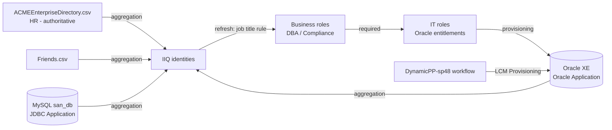

# SailPoint IdentityIQ Lab

A local SailPoint IdentityIQ 8.3 environment where I set up identity governance end to end: an HR source that creates identities, manager and attribute mapping, rule-based business roles, IT roles built from Oracle entitlements, and custom workflows that check for and provision Oracle database accounts.

**Author:** Sanskar Lohani | [slohani-22](https://github.com/slohani-22)

> **Status:** Built November 2026 and still in progress. Lifecycle events (Joiner/Mover/Leaver) are next. See [Roadmap](#roadmap).

---

## What This Lab Demonstrates

- An authoritative HR source (delimited file) that creates and updates identities on aggregation
- Identity attribute mapping, searchable attributes, and manager correlation from an HR `managerId` column
- Business roles assigned by rule from HR job title, each requiring an IT role
- IT roles defined by Oracle entitlements, and the difference between **assigned** and **detected** roles
- Provisioning a real Oracle XE database user from IIQ through the Oracle connector
- Custom workflows built in the Business Process Editor: forms, script steps, conditional transitions, and a hand-off to `LCM Provisioning`
- BeanShell rules for querying identities and roles and for building a provisioning plan
- A role design problem I found in my own role model, and how I would fix it

## IAM Domain Coverage

| Domain | Implemented in this lab |
|---|---|
| **Identity lifecycle data** | HR authoritative source, identity creation rule, attribute mapping, manager correlation |
| **Role-based access** | Business roles by assignment rule, required IT roles, entitlement-based role detection |
| **Provisioning** | Oracle connector account creation, provisioning policy forms, provisioning plans, LCM Provisioning |
| **Custom logic** | BeanShell rules, workflows with branching, QuickLinks to launch them |

---

## Environment

| Component | Version | Why this version |
|---|---|---|
| SailPoint IdentityIQ | 8.3 | Version provided for training |
| Java | Eclipse Temurin 11 | IIQ 8.3 supports Java 8 and 11. Java 17 support starts in 8.4. The machine already had JDK 27, so 11 runs alongside it and Tomcat is pointed at it explicitly |
| Apache Tomcat | 9.0.123 | IIQ 8.x is a Java EE (`javax`) app. Tomcat 10 and 11 are Jakarta EE and will not run it |
| MySQL | 8.0.46 | Supported by IIQ 8.3. The bundled JDBC driver (Connector/J 8.0.28) needed `allowPublicKeyRetrieval=true` in `iiq.properties` to connect |
| Oracle Database XE | 21c | Provisioning target |
| MySQL (`san_db`) | 8.0 | Second source, read through the JDBC connector |

## Architecture



---

## Applications

| Application | Connector | Role in the lab |
|---|---|---|
| HR Application | Delimited file | Authoritative. Creates identities from `ACMEEnterpriseDirectory.csv` (36 fictional employees) |
| Friends | Delimited file | Second file source with 15 fictional identities, used to practise aggregation and correlation |
| JDBC Application | JDBC (MySQL) | Reads an `employees` table. Its `jobTitle` drives the Forward/Midfield deployment business roles |
| Oracle Application | Oracle Database - Direct | Target. Accounts are Oracle users, entitlements are Oracle roles |

The HR application uses a creation rule (`Creation Rule- Set Password`) that names each new identity `firstName_lastName`.

## Identity Model

- Attributes mapped from HR: first name, last name, email, department, employee ID
- `employeeid` is **searchable**. Manager correlation needs it, because IIQ matches each account's `managerId` against that identity attribute with a database query
- Manager correlation on the HR application links each identity to its manager. The refresh task also runs **Refresh manager status**, so managers are marked as managers


## Role Model

| Business role | Assigned when | Requires IT role | IT role entitlements (Oracle `ROLES`) |
|---|---|---|---|
| DBA-Business | HR `jobtitle` = `dba` | DBA-IT | APEX_ADMINISTRATOR_ROLE, ADM_PARALLEL_EXECUTE_TASK, AQ_ADMINISTRATOR_ROLE, AQ_USER_ROLE, AUTHENTICATEDUSER |
| Compliance-Business | HR `jobtitle` = `Compliance Officer` | Compliance-IT | ADM_PARALLEL_EXECUTE_TASK, APEX_ADMINISTRATOR_ROLE |
| ForwardDeploymentRole-Business | JDBC `jobTitle` = `Forward` | ForwardDeploymentRole | AUTHENTICATEDUSER, APEX_ADMINISTRATOR_ROLE, AQ_ADMINISTRATOR_ROLE |
| MidfieldDeploymentRole-Business | JDBC `jobTitle` = `Midfielder` | MidfieldDeploymentRole | AQ_USER_ROLE, ADM_PARALLEL_EXECUTE_TASK, AUTHENTICATEDUSER, DATAPUMP_EXP_FULL_DATABASE |

How it plays out: the identity refresh evaluates each business role's assignment rule and **assigns** the role. Because the IT role is required, IIQ builds a provisioning request for the missing Oracle entitlements. Once the Oracle account holds them and Oracle is aggregated again, the next refresh **detects** the IT role.

Identities whose job title matches no rule correctly get no roles. Cam Oneill and Ryan Smith (Compliance Officers) show the intended flow: Compliance-Business assigned, Compliance-IT detected, Oracle entitlements present.


One identity with both an HR account and a provisioned Oracle account (test identity, name blurred):


---

## Workflows

### DynamicPP-sp48: check for an Oracle account, provision if missing

```
Start → Input Identity (form) → Check Oracle Account (script)
          ├─ identity not found      → Stop
          ├─ already has Oracle acct → Stop
          └─ otherwise               → Create PP (script) → LCM Provisioning → Stop
```

- The form uses an Identity picker. It returns the identity's **ID**, so the check step uses `context.getObject()` (accepts ID or name) rather than `getObjectByName()`
- The check step stores the identity name in `identityName` with `wfcontext.setVariable` and returns `true`/`false` into `hasOracleAccount` through its **Result Variable**
- It decides by counting identities with `Filter.eq("links.application.name", "Oracle Application")` and `Filter.eq("name", idenName)`
- Create PP builds a `ProvisioningPlan` with one `Create` `AccountRequest` for Oracle and returns it into `plan`
- `LCM Provisioning` receives `plan` and `identityName`, renders the Oracle connector's Create User form, and creates the user in Oracle XE


The provisioning form is shown before filling it in. Credentials are deliberately left out.

### Test - Job identities: find people by HR job title

```
Start → Input Job Title (form) → Find Names (script) → List-identity (form)
      → Get Emails (script) → Output (form) → Stop
```

Searches only **HR Application accounts** (`Link` objects filtered on `application.name`) and compares each account's own `jobtitle`. Other applications also feed job titles, so reading the HR account directly guarantees the match is based on HR data. The user then picks from the matching names and gets their emails.


Both workflows are launched from the side menu through QuickLinks (`quicklinks/`).

## Rules

| Rule | What it does |
|---|---|
| `Creation Rule- Set Password` | Identity creation rule on the HR app. Names identities `firstName_lastName` and sets a default IIQ password (lab only, see below) |
| `Test Rule` | Lists the applications an identity has accounts on (`identity.getLinks()`) |
| `Test Rule 2` | Lists every identity with its email |
| `Test Rule- Role` | Lists every role (`Bundle`) with its type, business or IT |
| `sp_PP` | First version of the provisioning plan logic, before it moved into the DynamicPP-sp48 workflow |

---

## Finding: Overlapping IT Roles Cause False Detection

The IT roles were deliberately built from overlapping Oracle entitlements so I could observe how role detection behaves.

**What I saw:** a test identity with job title `dba` was assigned DBA-Business and detected for DBA-IT, as expected. It was **also detected for Compliance-IT and ForwardDeploymentRole**, which nothing had assigned to it.

**Why:** IIQ detects an IT role whenever an account holds all of the IT role's entitlements, no matter how the matching business role is assigned. ForwardDeploymentRole-Business is assigned from the JDBC application (`jobTitle = Forward`), but its IT role, ForwardDeploymentRole, is defined on Oracle entitlements. Both Compliance-IT and ForwardDeploymentRole use Oracle entitlements that are a strict subset of DBA-IT's, so anyone with DBA access is detected for them too. MidfieldDeploymentRole (also assigned from JDBC) was not detected because its Oracle entitlements include `DATAPUMP_EXP_FULL_DATABASE`, which DBA-IT does not have.

**Why it matters:** in a real environment this puts people into access reviews and SoD checks for roles they were never given, which wastes reviewer time and can produce false policy violations.

**How I would fix it:** give each IT role a distinct entitlement set, and avoid building roles from entitlements every account gets, such as `AUTHENTICATEDUSER`.


---

## Troubleshooting Log

| Problem | Cause | Fix |
|---|---|---|
| MySQL80 service would not start ("Access denied") | Install folder on the D: drive had no permissions for `NT AUTHORITY\NetworkService`, the account the service runs as | Granted NetworkService read/execute on the install folder and full control on the data folder with `icacls` |
| MySQL started with no database | Data directory pointed at an existing folder, so the installer skipped initialization | Reinstalled with separate install and data folders |
| Manager field empty after refresh | Manager needs both an identity mapping and manager correlation, and the correlation target must be searchable | Made `employeeid` searchable, added `managerId` as the manager source, refreshed with manager status |
| Department mapped but not visible on the identity page | The Attributes tab only shows attributes listed in `UIConfig` → `identityViewAttributes` | Added the attribute to that list |
| Provisioning form kept coming back ("Duplicate question found in history") | The plan said `Oracle application`, the app is `Oracle Application`. The database lookup ignores case, so the form rendered, but IIQ's in-memory match does not, so answers never attached | Used the exact application name |
| Workflow always went to Create PP | Result Variable on the wrong step, a step-level condition instead of a transition condition, and the unconditional transition listed first | Result Variables on the steps that return values, conditions on transitions, default transition last |
| Script in a form step ran before the form was submitted | A step's script does not wait for its form | Moved each script into its own step after the form |

## Key Design Decisions

**HR as the only authoritative source.** Identities are created from one trusted system. Other applications correlate to them instead of creating their own.

**Business roles assigned by rule, IT roles required.** Job title decides *who* gets access, and the IT role decides *what* that access is. A job-title change then changes access without anyone editing accounts by hand.

**Read the HR account, not the identity, when HR data must win.** Several sources feed similar attributes, so the job-title workflow reads the HR `Link` directly.

**Pass names between workflow steps, not objects.** Workflow variables are persisted between steps, so steps pass identity names or IDs and fetch the `Identity` again where needed.

## Lab Shortcuts (Not for Production)

- The JDBC and Oracle connectors use the database admin accounts (`root`, `system`). In production each connector would use a dedicated least-privilege service account. Credentials in this repo are replaced with `CHANGE_ME`
- `Creation Rule- Set Password` gives every new identity the same default password. In production, identities would authenticate through SSO, or get a unique random initial password with a forced change
- Source CSVs sat inside the IIQ web app folder. They belong in a separate folder so a redeploy cannot remove them

---

## Repository Structure

```
Sailpoint_IIQ-Lab/
├── README.md
├── config/
│   ├── applications/       # HR, Friends, JDBC, Oracle (credentials removed)
│   ├── identity-mappings/  # ObjectConfig-Identity (includes IIQ's standard attributes)
│   ├── roles/              # 4 business + 4 IT roles
│   └── tasks/              # Aggregations and Generic Identity Refresh
├── data/                   # Fictional source CSVs
├── docs/screenshots/
├── quicklinks/
├── rules/
└── workflows/
```

## How to Import

Requires a working IIQ 8.3 install. Import order matters because objects reference each other by name.

1. Copy `data/*.csv` to a folder on the IIQ server and update the `file` path in `HR-Application.xml` and `Friends.xml`
2. Replace every `CHANGE_ME` with your own connection details
3. In `iiq console`, import in this order:
   ```
   import rules/Creation-Rule-Set-Password.xml
   import config/applications/HR-Application.xml
   import config/applications/Friends.xml
   import config/applications/JDBC-Application.xml
   import config/applications/Oracle-Application.xml
   import config/identity-mappings/ObjectConfig-Identity.xml
   import config/roles/<IT roles first, then business roles>
   import config/tasks/<each task>
   import rules/<remaining rules>
   import workflows/<each workflow>
   import quicklinks/<each QuickLink>
   ```
4. Run the HR aggregation, then the other aggregations, then `Generic Identity Refresh`

`ObjectConfig-Identity.xml` replaces the whole identity configuration. Only import it into a fresh environment.

---

## Roadmap

- [ ] Lifecycle events: Joiner, Mover, Leaver driven by HR changes
- [ ] Certification campaigns: manager access reviews
- [ ] SoD policy, for example DBA vs. Compliance
- [ ] Fix the overlapping IT roles and re-test detection
- [ ] Microsoft Entra ID as a provisioning target
- [ ] SSO into IdentityIQ through Entra ID

## Related Project

[SecureCorp AWS IAM Lab](https://github.com/slohani-22/SecureCorp-AWS-IAM-Lab) covers cloud IAM on AWS with Entra ID federation. This lab covers identity governance in an IGA platform.
